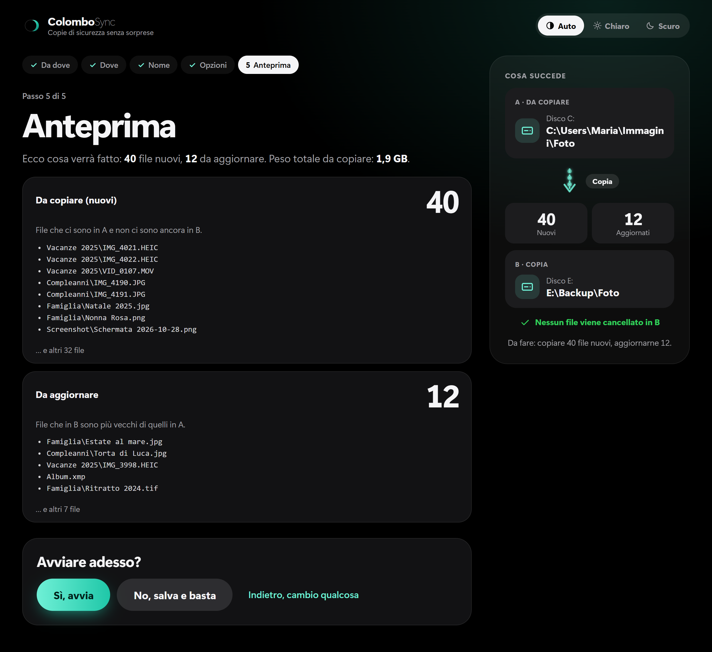
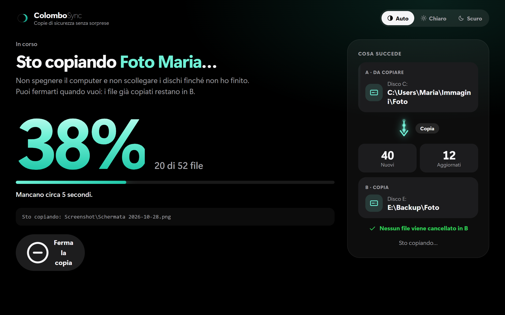
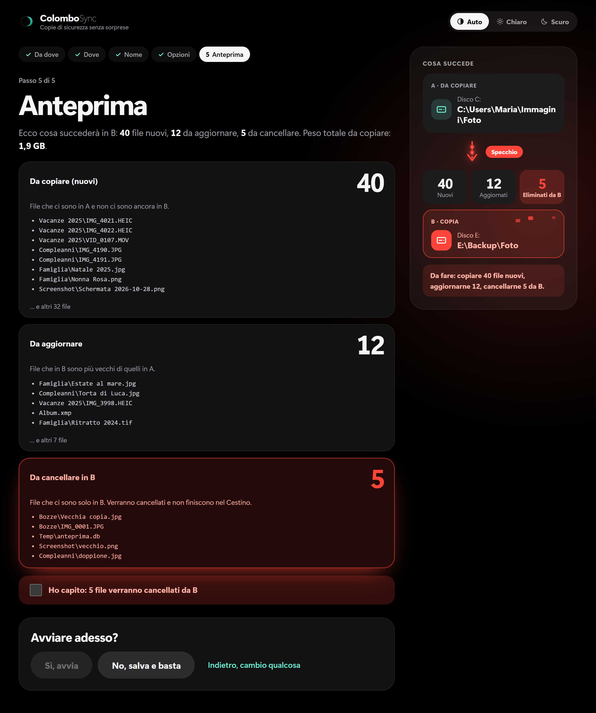
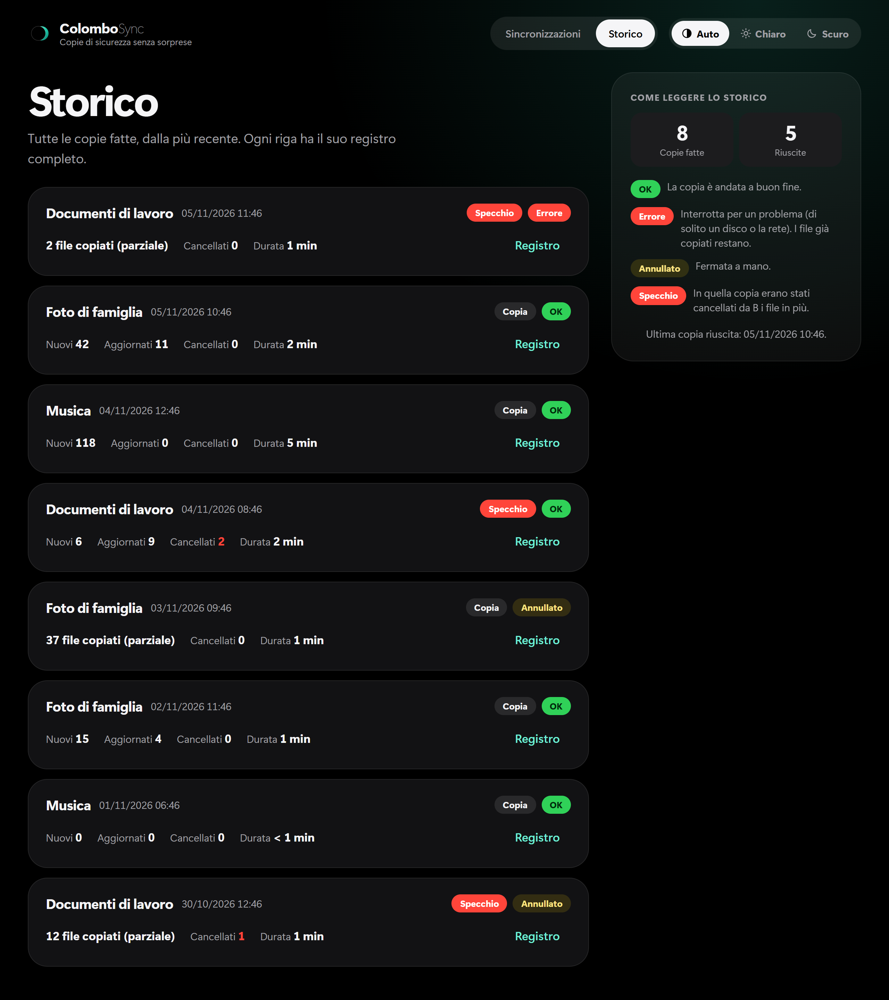

<div align="center">


# ColomboSync

**Copia una cartella in un'altra, in sicurezza. Prima di copiare vedi sempre cosa succederà.**

[](https://github.com/mikeleg/colomboSync/releases/latest)

[](LICENSE)

### [⬇️ Scarica ColomboSync](https://github.com/mikeleg/colomboSync/releases/latest)

Per Windows, Mac e Linux. Niente installazione.

<br>



</div>

## Come funziona

Hai una cartella con i tuoi file (la chiamiamo **A**) e vuoi tenerne una copia su un altro disco, una chiavetta o una cartella di rete (la chiamiamo **B**).

1. Scegli la cartella A.
2. Scegli la cartella B.
3. Dai un nome alla sincronizzazione.
4. Guarda l'anteprima: ColomboSync ti mostra quanti file sono nuovi, quanti vengono aggiornati e, solo se lo chiedi tu, quanti vengono cancellati.
5. Premi **Sì, avvia**.

La volta dopo basta un clic: la sincronizzazione resta salvata nell'elenco.

<table>
  <tr>
    <td align="center"><br><sub>Le tue sincronizzazioni, pronte da rilanciare con un clic</sub></td>
    <td align="center"><br><sub>La copia in corso, con avanzamento e tempo che manca</sub></td>
  </tr>
  <tr>
    <td align="center"><br><sub>Modalità specchio: i file da cancellare sono in rosso</sub></td>
    <td align="center"><br><sub>Lo storico di tutte le copie, ognuna con il suo registro</sub></td>
  </tr>
  <tr>
    <td align="center" colspan="2"><br><sub>Tema chiaro, scuro o automatico: scegli tu</sub></td>
  </tr>
</table>

## Perché ColomboSync

- **Si capisce subito.** Una procedura guidata in pochi passaggi, tutta in italiano. Non serve il terminale.
- **Vedi prima di fare.** L'anteprima è obbligatoria, ogni volta. Uno schema da A a B ti mostra quanti file verranno copiati, aggiornati o cancellati.
- **Di solito non cancella niente.** Di base ColomboSync copia e basta: non cancella mai nulla in B. Solo se attivi la modalità specchio (nelle opzioni avanzate) i file in più in B vengono cancellati, e prima devi confermare.
- **Gli errori hanno parole chiare.** Se un disco si scollega o una cartella non si trova, ti dice cosa è successo e cosa puoi fare. Niente codici incomprensibili.
- **Tutto resta registrato.** Lo storico elenca ogni copia con data, esito e durata. Per ognuna puoi aprire il registro completo.
- **Segui la copia e fermati quando vuoi.** Vedi l'avanzamento in tempo reale. Se ti fermi, i file già copiati restano in B.
- **Leggero e senza installazione.** Un solo file da aprire. Usa il programma di copia che il tuo computer ha già: robocopy su Windows, rsync su Mac e Linux.

## Scarica e installa

Vai alla pagina [**Download**](https://github.com/mikeleg/colomboSync/releases/latest) e scegli il file per il tuo computer. Al posto di `…` nel nome c'è il numero della versione.

| Sistema | File da scaricare |
|---|---|
| Windows 10/11 | `ColomboSync-…-windows-x64.exe` |
| macOS (Intel e Apple Silicon) | `ColomboSync-…-macos-universal.dmg` |
| Linux x86_64 | `ColomboSync-…-linux-x86_64.AppImage` |

### Come installare

- **Windows:** scarica `ColomboSync-…-windows-x64.exe` e mettilo dove vuoi (per esempio sul Desktop). La prima volta Windows può dire "Windows ha protetto il PC": clicca **Ulteriori informazioni** → **Esegui comunque**.
- **Mac:** apri il `.dmg` e trascina ColomboSync in Applicazioni. La prima volta: tasto destro sull'app → **Apri** → **Apri** (su macOS recenti: Impostazioni di Sistema → Privacy e sicurezza → **Apri comunque**).
- **Linux:** scarica l'`.AppImage`, rendilo eseguibile (tasto destro → Proprietà → "Consenti l'esecuzione", oppure `chmod +x`) e aprilo. Serve `rsync` installato.
- **Aggiornare:** scarica la nuova versione e sostituisci la vecchia. Sincronizzazioni e storico restano (sono salvati nella cartella dell'utente, non accanto al programma).

I checksum dei file sono in `SHA256SUMS.txt`, nella stessa pagina.

### Requisiti

- **Windows:** Windows 10 o 11 a 64 bit con WebView2 (già presente su Windows 10 e 11).
- **macOS:** macOS 11 o successivo, Mac Intel e Apple Silicon. Provato su macOS 15 o successivo: sulle versioni più vecchie il programma di copia di sistema è diverso e non è stato provato.
- **Linux:** x86_64, con `rsync` installato.

## Domande frequenti

**È sicuro?**
ColomboSync è pensato per non farti perdere file. L'anteprima è obbligatoria prima di ogni copia. Rifiuta di copiare se la cartella B è uguale alla A o sta dentro la A (e viceversa). In modalità specchio si blocca da solo se la cartella A risulta vuota o scollegata, oppure se in B verrebbero cancellati più file di quelli che arrivano da A. Non chiede mai i permessi di amministratore.

**Cancella i miei file?**
Di base no: nella copia normale non cancella mai niente in B. Se però un file c'è sia in A sia in B ed è diverso, quello in B viene sostituito con quello di A, anche se quello in B è più recente: l'anteprima te lo mostra tra i file da aggiornare. Solo con la modalità specchio, che attivi tu nelle opzioni avanzate, i file che ci sono solo in B vengono cancellati. L'anteprima te li mostra in rosso e devi confermare. Attenzione: i file cancellati così non finiscono nel Cestino.

**Perché Windows o macOS mi avvisano la prima volta?**
Il programma non è firmato con un certificato a pagamento. Per questo Windows scrive "Windows ha protetto il PC" e il Mac chiede conferma per aprirlo. È normale: i passaggi da seguire sono in [Come installare](#come-installare). Se vuoi, puoi controllare che il file sia quello originale con `SHA256SUMS.txt`.

**Dove salva le impostazioni?**
Le sincronizzazioni, lo storico e i registri stanno nella tua cartella utente, non accanto al programma:

| Sistema | Cartella |
|---|---|
| Windows | `%LOCALAPPDATA%\ColomboSync` |
| macOS | `~/Library/Application Support/ColomboSync` |
| Linux | `$XDG_DATA_HOME/ColomboSync` oppure `~/.local/share/ColomboSync` |

Per questo, quando aggiorni il programma, non perdi niente.

**Funziona con NAS e chiavette?**
Sì: A e B possono essere dischi del computer, chiavette, dischi esterni o cartelle di rete. Su Windows puoi usare una lettera di unità (per esempio `Z:\`) oppure un percorso di rete come `\\server\cartella`. Su Mac e Linux la cartella deve essere già collegata (per esempio sotto `/Volumes`). Non sono previsti collegamenti a computer remoti via internet (SSH).

## Stato del progetto

ColomboSync è in **beta** (versioni 0.x). Funziona, ma è ancora giovane: prima della 1.0 vogliamo provarlo con persone vere. Se qualcosa non va, o hai un'idea, [apri una segnalazione](https://github.com/mikeleg/colomboSync/issues): ogni commento è benvenuto.

Per ora è solo copia da A a B, a mano: niente copie automatiche a orari fissi, niente sincronizzazione nei due sensi, niente filtri per escludere cartelle o tipi di file.

## Per sviluppatori

Desktop app: **Tauri 2** (Rust, `src-tauri/`) + **Svelte 5** + Vite + TypeScript (`src/`). The copy engine is the one already on the system: `robocopy` on Windows, `rsync` on macOS (openrsync) and Linux (GNU rsync). Rust owns all logic, I/O and every user-facing message; Svelte only renders.

```
npm test                              # Svelte tests (vitest, jsdom)
npm run check                         # svelte-check / TypeScript
cd src-tauri && cargo fmt && cargo test
cd src-tauri && cargo clippy --all-targets -- -D warnings
npm run tauri dev                     # run the app in dev
npm run portable                      # Windows exe: src-tauri\target\release\colombo-sync.exe
npx tauri build --bundles app,dmg     # macOS only (CI builds it)
npx tauri build --bundles appimage    # Linux only (CI builds it)
```

Where to read more:

- [`CLAUDE.md`](CLAUDE.md): agent guide, architecture rules and conventions.
- [`docs/backlog/colombo-sync/`](docs/backlog/colombo-sync/): `scope.md` (what is in and out, decisions), `backlog.md` (slices and acceptance criteria), `prototype.html` (flow and exact Italian copy).
- [`docs/agents/`](docs/agents/): glossary, engine facts ([robocopy](docs/agents/robocopy.md), [rsync](docs/agents/rsync.md)), GitHub and CI, how we work.
- [`docs/release-plan.md`](docs/release-plan.md): how releases are built and published.

## Licenza

[MIT](LICENSE) © 2026 Michele Gatti
